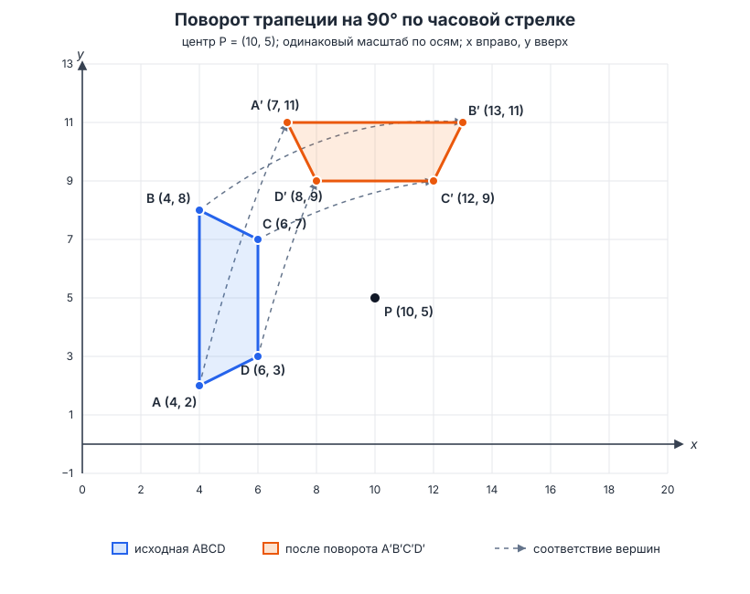

# Лабораторная работа № 4 – аффинные преобразования и геометрия прямой

## Цель работы

Изучить аффинные преобразования плоских фигур и способы описания прямых; научиться находить центр поворота, выполнять перенос и поворот фигуры матричным способом и анализировать положение геометрических объектов.

## Задачи работы

1. Задать вершины трапеции в декартовой системе координат.
2. Найти точку пересечения продолжений наклонных сторон и использовать её как центр поворота.
3. Представить перенос и поворот однородными матрицами, правильно определить порядок их применения.
4. Повернуть вершины трапеции на $90^\circ$ по часовой стрелке и вычислить новые координаты.
5. Изобразить исходную и преобразованную фигуры на одной координатной плоскости и проверить результат по рисунку.
6. Повторить формы уравнения прямой и методы определения взаимного положения точек, прямых и отрезков.

В Mathcad-файлах исходная трапеция задана вершинами $A=(4,2)$, $B=(4,8)$, $C=(6,7)$, $D=(6,3)$. Продолжения сторон $AD$ и $BC$ пересекаются в точке $P=(10,5)$; вокруг неё выполняется поворот.

## Аффинные преобразования: смысл и основные операции

**Аффинное преобразование** переводит точку плоскости в точку по правилу

$$
\mathbf{x}' = M\mathbf{x} + \mathbf{t},
$$

где $M$ – матрица линейной части (поворот, масштабирование, отражение, сдвиг/срез), а $\mathbf{t}$ – вектор переноса. В однородных координатах $\mathbf{v}=(x,y,1)^T$ это записывается единой матрицей:

$$
\begin{pmatrix}x'\\y'\\1\end{pmatrix}
=
\begin{pmatrix}m_{11}&m_{12}&t_x\\m_{21}&m_{22}&t_y\\0&0&1\end{pmatrix}
\begin{pmatrix}x\\y\\1\end{pmatrix}.
$$

Частные аффинные операции:

| Операция | Координатное правило | Что меняется |
|---|---|---|
| Перенос | $(x',y')=(x+t_x,y+t_y)$ | Положение, форма сохраняется |
| Масштабирование | $(x',y')=(s_xx,s_yy)$ | Размер; при $s_x\ne s_y$ меняются пропорции |
| Поворот | Матрица поворота, см. ниже | Направление фигуры; расстояния и углы сохраняются |
| Отражение | Например, относительно оси $X$: $(x',y')=(x,-y)$ | Ориентация меняется на противоположную |
| Сдвиг (shear) | $x'=x+ky$, $y'=y$ | Прямые остаются прямыми, углы и длины обычно меняются |

Композиция нескольких операций также является аффинным преобразованием. Порядок матриц важен: для вектора-столбца преобразования справа налево. Невырожденная аффинная матрица сохраняет прямолинейность, коллинеарность и параллельность, но в общем случае не сохраняет длины и углы. Поворот и перенос – жёсткие движения: они сохраняют расстояния и углы.

## Поворот по часовой стрелке

Пусть $P=(p_x,p_y)$ – центр вращения, а $\theta>0$ – угол, отсчитываемый по часовой стрелке. Для вектора-столбца матрица поворота:

$$
R_{\mathrm{cw}}(\theta)=
\begin{pmatrix}
\cos\theta & \sin\theta & 0\\
-\sin\theta & \cos\theta & 0\\
0&0&1
\end{pmatrix}.
$$

**Знак синуса связан с направлением поворота.** При движении по часовой стрелке нижний левый элемент равен $-\sin\theta$. Для $\theta=90^\circ$ матрица переводит вектор $(1,0)$ в $(0,-1)$, то есть с положительного направления оси $X$ вниз по оси $Y$.

Чтобы вращать не вокруг начала координат, а вокруг $P$, выполняют три аффинные операции: перенос центра в начало, поворот, обратный перенос:

$$
\begin{pmatrix}x'\\y'\\1\end{pmatrix}
=
\begin{pmatrix}1&0&p_x\\0&1&p_y\\0&0&1\end{pmatrix}
R_{\mathrm{cw}}(\theta)
\begin{pmatrix}1&0&-p_x\\0&1&-p_y\\0&0&1\end{pmatrix}
\begin{pmatrix}x\\y\\1\end{pmatrix}.
$$

Для поворота на $90^\circ$ по часовой стрелке формулы координат упрощаются:

$$
\begin{aligned}
x' &= p_x + (y-p_y),\\
y' &= p_y - (x-p_x).
\end{aligned}
$$

В Mathcad-файле используется эквивалентное соглашение: стандартная матрица поворота против часовой стрелки, но угол задан отрицательным, $\varphi=-90^\circ$. Тогда $\sin\varphi=-1$; элементы $-\sin\varphi$ и $\sin\varphi$ дают нужный знак для вращения по часовой стрелке. Матрицы преобразования записаны для однородных векторов-столбцов.

## Пример по Mathcad: трапеция поворачивается на $90^\circ$ по часовой стрелке

В файле заданы вершины $A=(4,2)$, $B=(4,8)$, $C=(6,7)$, $D=(6,3)$. Найдём пересечение продолжений наклонных сторон $AD$ и $BC$. Их уравнения:

$$
AD: y = 0.5x, \qquad BC: y = -0.5x + 10.
$$

Приравнивая правые части, получаем $0.5x=-0.5x+10$, откуда $x=10$, $y=5$. Следовательно, центр вращения $P=(10,5)$.

Для движения по часовой стрелке в Mathcad задаётся угол $\varphi=-90^\circ$. Используем стандартную матрицу вращения с углом, положительным против часовой стрелки:

$$
R(\varphi)=
\begin{pmatrix}
\cos\varphi & -\sin\varphi & 0\\
\sin\varphi & \cos\varphi & 0\\
0&0&1
\end{pmatrix}.
$$

Так как $\cos(-90^\circ)=0$ и $\sin(-90^\circ)=-1$, первая строка матрицы содержит $+1$ при $y$, а вторая – $-1$ при $x$. **Минус перед синусом во второй строке и отрицательное значение самого синуса дают вращение по часовой стрелке.** Относительно центра $P$ формулы становятся $x'=p_x+(y-p_y)$, $y'=p_y-(x-p_x)$.

Применяем их к вершинам:

$$
\begin{array}{c|c|c}
\text{Вершина} & \text{До поворота} & \text{После поворота}\\
A & (4,2) & (7,11)\\
B & (4,8) & (13,11)\\
C & (6,7) & (12,9)\\
D & (6,3) & (8,9)
\end{array}
$$

**Проверка:** центр $P$ остаётся неподвижным; расстояние каждой вершины до $P$ сохраняется. Например, $PA^2=(4-10)^2+(2-5)^2=45$ и $PA'^2=(7-10)^2+(11-5)^2=45$.

### График поворота

На рисунке показаны исходная и повернутая трапеции, центр вращения $P$ и соответствие вершин. По часовой стрелке при виде на координатную плоскость направлены стрелки $A\to A'$, $B\to B'$, $C\to C'$, $D\to D'$.

___

## 1. Прямая на плоскости: разные формы одного объекта

### Неявное уравнение

$$
F(x,y) = ax + by + c = 0, \qquad (a,b) \ne (0,0).
$$

Вектор $\mathbf n = (a,b)$ перпендикулярен прямой и называется её **нормалью**. Подстановка точки $(x_0,y_0)$ в $F$ позволяет проверить, лежит ли она на прямой: $F(x_0,y_0) = 0$.

- Если $F(x_0,y_0) > 0$ или $F(x_0,y_0) < 0$, точка находится в одной из двух полуплоскостей.
- Две точки лежат по одну сторону от прямой, если значения $F$ у них одного знака; по разные стороны – если знаки разные.
- Неявная форма удобна для вертикальных прямых и для тестов пересечения.

### Нормальное уравнение через точку и нормаль

Прямая, проходящая через $P_0 = (x_0,y_0)$ и имеющая нормаль $\mathbf n = (a,b)$, задаётся условием ортогональности:

$$
a(x-x_0) + b(y-y_0) = 0.
$$

После раскрытия скобок получается $ax + by + c = 0$, где $c = -(ax_0 + by_0)$.

### Явное уравнение

Если $b \ne 0$, неявную форму можно решить относительно $y$:

$$
y = kx + p, \qquad k = -\frac{a}{b}, \qquad p = -\frac{c}{b}.
$$

$k$ – угловой коэффициент, $p$ – пересечение с осью $Y$. Вертикальная прямая имеет вид $x = \mathrm{const}$ и не представима как $y = kx + p$ с конечным $k$.

### Уравнение в отрезках

Если прямая пересекает обе оси в ненулевых точках $(p,0)$ и $(0,q)$, её можно записать так:

$$
\frac{x}{p} + \frac{y}{q} = 1.
$$

Форма требует $p \ne 0$ и $q \ne 0$; для прямой, проходящей через начало координат, она неприменима.

### Параметрическая и каноническая формы

Пусть $P_0 = (x_0,y_0)$ – точка прямой, а $\mathbf q = (m,n) \ne (0,0)$ – направляющий вектор, параллельный ей. Тогда:

$$
\begin{aligned}
(x,y) &= (x_0,y_0) + t(m,n),\\
x &= x_0 + tm, \qquad y = y_0 + tn.
\end{aligned}
$$

$t \in \mathbb R$ задаёт всю прямую; $t \in [0,1]$ задаёт отрезок между точками при соответствующем выборе концов. Исключая параметр, получаем каноническую форму:

$$
\frac{x-x_0}{m} = \frac{y-y_0}{n}.
$$

Если $m = 0$ или $n = 0$, не делите на ноль: используйте исходные параметрические уравнения или перемножьте пропорцию крест-накрест.

Через две различные точки $P_1 = (x_1,y_1)$ и $P_2 = (x_2,y_2)$ прямая задаётся направляющим вектором $P_2-P_1$:

$$
P(t) = P_1 + t(P_2-P_1).
$$

При $t \in [0,1]$ получаем именно отрезок $P_1P_2$.

## 2. Расстояние и угол

Для прямой $ax + by + c = 0$ расстояние от точки $P_0 = (x_0,y_0)$ до неё равно

$$
d(P_0,L) = \frac{|ax_0 + by_0 + c|}{\sqrt{a^2+b^2}}.
$$

Абсолютное значение нужно, чтобы расстояние было неотрицательным; знаменатель нормирует результат на длину вектора нормали.

Для ненулевых векторов $\mathbf u$ и $\mathbf v$ угол между направлениями находится через скалярное произведение:

$$
\varphi = \arccos\left(\frac{\mathbf u \cdot \mathbf v}{\|\mathbf u\|\,\|\mathbf v\|}\right).
$$

Для угла между прямыми можно использовать их направляющие векторы или нормали. Если нужен меньший неориентированный угол, в числителе используют $|\mathbf u \cdot \mathbf v|$, чтобы получить угол в диапазоне $[0,\pi/2]$.

## 3. Взаимное положение прямых

Пусть заданы две прямые:

$$
\begin{aligned}
a_1x + b_1y + c_1 &= 0,\\
a_2x + b_2y + c_2 &= 0.
\end{aligned}
$$

Точка пересечения – решение системы. Определитель коэффициентов

$$
\Delta = a_1b_2 - a_2b_1.
$$

- $\Delta \ne 0$ – прямые пересекаются в одной точке.
- $\Delta = 0$ – прямые параллельны либо совпадают; для различения сравните коэффициенты и свободные члены, то есть проверьте пропорциональность всех трёх коэффициентов.

Не делите на $\Delta$, пока не проверили его величину. В вычислениях с плавающей точкой вместо строгого сравнения с нулём обычно проверяют $|\Delta| < \varepsilon$ с выбранным допуском.

## 4. Пересечение двух отрезков

Для отрезков $A(t) = A_1 + t(A_2-A_1)$ и $B(s) = B_1 + s(B_2-B_1)$ приравняйте координаты:

$$
A_1 + t(A_2-A_1) = B_1 + s(B_2-B_1).
$$

Это система двух линейных уравнений для $t$ и $s$. Если $A_i=(x_{A_i},y_{A_i})$ и $B_i=(x_{B_i},y_{B_i})$, её можно записать так:

$$
\begin{pmatrix}
x_{A_2}-x_{A_1} & -(x_{B_2}-x_{B_1})\\
y_{A_2}-y_{A_1} & -(y_{B_2}-y_{B_1})
\end{pmatrix}
\begin{pmatrix}t\\s\end{pmatrix}
=
\begin{pmatrix}x_{B_1}-x_{A_1}\\y_{B_1}-y_{A_1}\end{pmatrix}.
$$

- Если система имеет единственное решение и $t,s \in [0,1]$, отрезки пересекаются; точка пересечения – $A(t)$.
- Если решение существует, но один из параметров вне $[0,1]$, пересекаются продолжения прямых, а не оба конечных отрезка.
- Если определитель системы равен нулю, отрезки параллельны или лежат на одной прямой. Этот вырожденный случай нужно обработать отдельно: проверить коллинеарность, затем перекрытие проекций на ось ненулевого направления.
- Отдельно обработайте вырожденный отрезок $A_1=A_2$ (точка), совпадающие концы и касание концами.

Численные тесты на границах диапазона должны учитывать допуск: например, считать параметр принадлежащим $[0,1]$, если $-\varepsilon \le t \le 1+\varepsilon$, после чего при необходимости ограничить его интервалом.

## 5. Положение точки относительно треугольника

Пусть треугольник $ABC$ невырожден. Векторное произведение в плоскости сводится к определителю:

$$
\operatorname{cross}(\mathbf u,\mathbf v) = u_xv_y-u_yv_x,
\qquad
S_{ABC} = \frac{|\operatorname{cross}(B-A,C-A)|}{2}.
$$

Способ из лекции основан на площадях. Для точки $P$ вычислите $S_{PAB}$, $S_{PBC}$, $S_{PCA}$ и сравните их сумму с площадью треугольника:

$$
\begin{aligned}
S_{PAB}+S_{PBC}+S_{PCA} &\approx S_{ABC} &&\Longrightarrow P\text{ внутри или на границе},\\
S_{PAB}+S_{PBC}+S_{PCA} &> S_{ABC} &&\Longrightarrow P\text{ вне треугольника}.
\end{aligned}
$$

Используйте допуск $\varepsilon$, а не точное сравнение вещественных чисел. Если $S_{ABC} \approx 0$, треугольник вырожден – результат нужно определять как для отрезка или точки, а не делить на его площадь.

Альтернативный тест – знаки ориентированных площадей $\operatorname{cross}(B-A,P-A)$, $\operatorname{cross}(C-B,P-B)$, $\operatorname{cross}(A-C,P-C)$: для точки внутри все знаки согласованы или равны нулю на ребре. Сначала зафиксируйте ориентацию вершин $ABC$ – против или по часовой стрелке.

## 6. Аффинные преобразования в Mathcad-файле

В `lab4/4lab.xmcd` и вспомогательном `helper/lab4/lab44.xmcd` заданы вершины трапеции и матричный поворот вокруг точки $P$. Общая идея переноса объекта, вращения и возврата:

1. Перенести центр вращения $P=(p_x,p_y)$ в начало координат.
2. Повернуть каждую вершину на угол $\varphi$.
3. Перенести вершины обратно.

Для **вектора-столбца** $V=(x,y,1)^T$ и стандартного математического направления положительного угла против часовой стрелки:

$$
T_- = \begin{pmatrix}1&0&-p_x\\0&1&-p_y\\0&0&1\end{pmatrix},\qquad
R(\varphi) = \begin{pmatrix}\cos\varphi&-\sin\varphi&0\\\sin\varphi&\cos\varphi&0\\0&0&1\end{pmatrix},
$$

$$
T_+ = \begin{pmatrix}1&0&p_x\\0&1&p_y\\0&0&1\end{pmatrix},\qquad
V' = T_+R(\varphi)T_-V.
$$

При такой договорённости отрицательный угол даёт поворот по часовой стрелке. Умножение матриц справа налево: сначала $T_-$, затем $R$, затем $T_+$. При использовании в Mathcad проверьте, представлены ли точки вектор-столбцами или вектор-строками. Для вектор-строк каждую матрицу надо транспонировать и умножать справа: соглашения нельзя смешивать.

## Что проверить в решении

- Все точки и формулы используют одну систему координат и один порядок координат $(x,y)$.
- Параметры и определители проверяются на вырожденность до деления.
- Для отрезка параметры пересечения принадлежат $[0,1]$; для прямой параметр не ограничен.
- Точки на линии, ребре или вершине считаются граничными случаями, а не ошибочно «снаружи».
- Поворот проверяется на простой точке и на $\varphi=0$; положительное направление угла указано явно.

## Источники в репозитории

- Перечень тем ЛР4: [вопросы к ЛР4](../helper/lab4/Документ%20Microsoft%20Word.docx).
- Примеры координат и матричного поворота: [Mathcad-файл ЛР4](4lab.xmcd), [вспомогательный файл](../helper/lab4/lab44.xmcd).
- Уравнения прямой, расстояние, угол, положение точек и прямых, пересечение отрезков и точка в треугольнике: лекция, глава 7.2, печатные страницы 59–74 – [открыть PDF с начала главы](../lectures/Основы%20КГиГ_New_12_Disk_Лекции_1.pdf#page=57).
- Аффинные преобразования на плоскости: лекция, глава 8, печатные страницы 91–100 – [открыть PDF с начала главы](../lectures/Основы%20КГиГ_New_12_Disk_Лекции_1.pdf#page=89).
- В PDF-страницах ссылок учтён сдвиг относительно печатной нумерации лекции.
